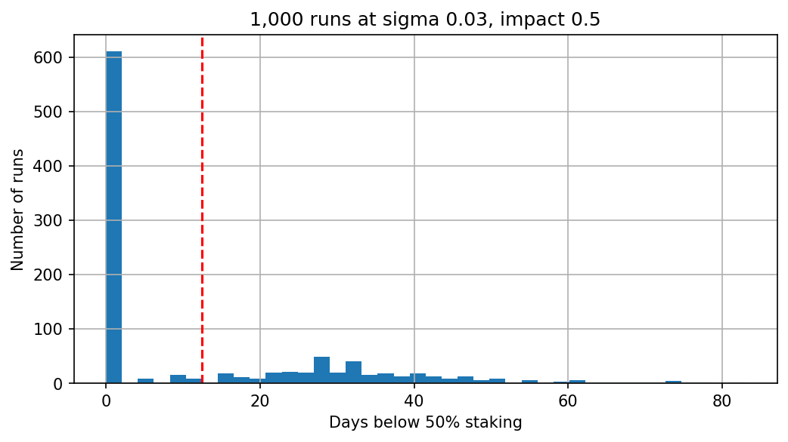
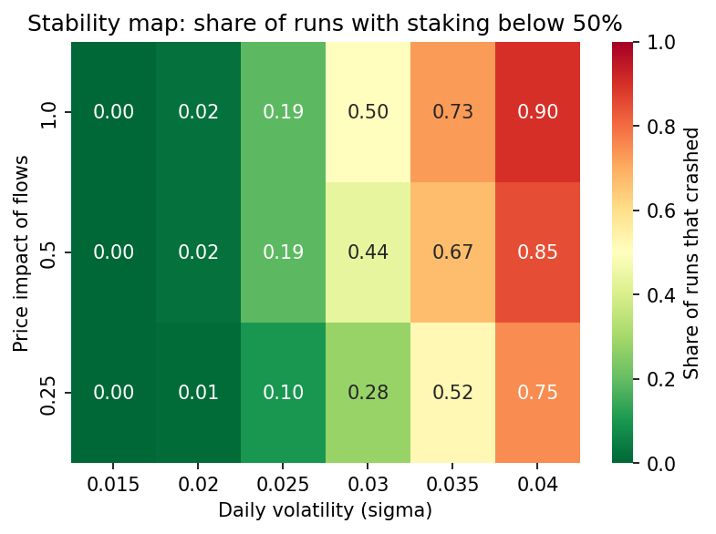
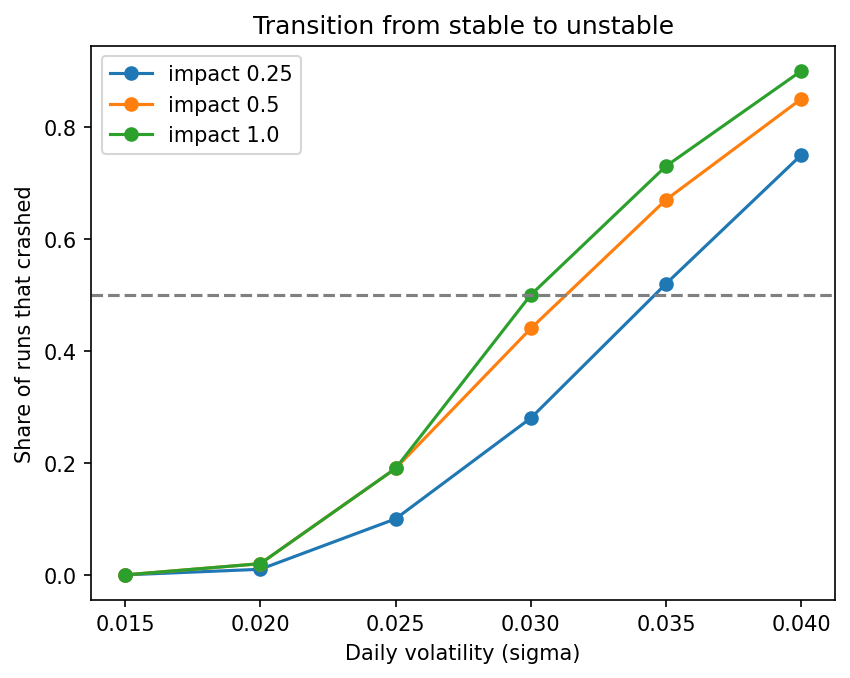
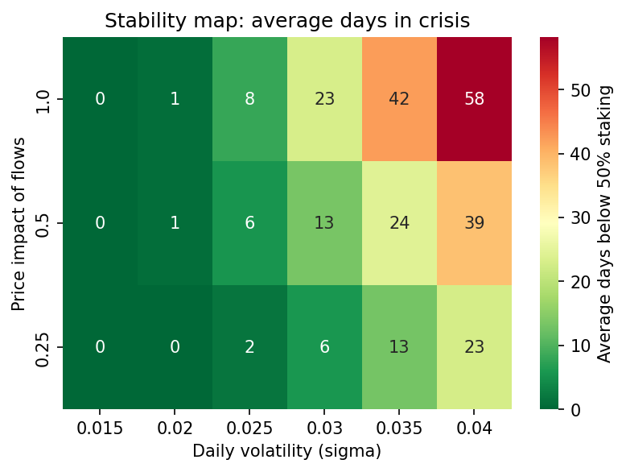
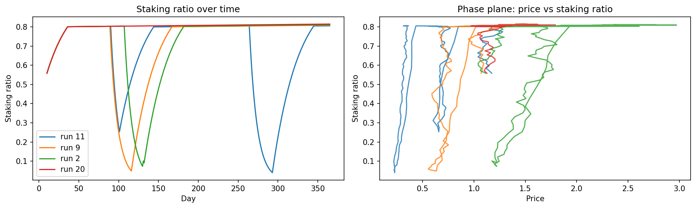
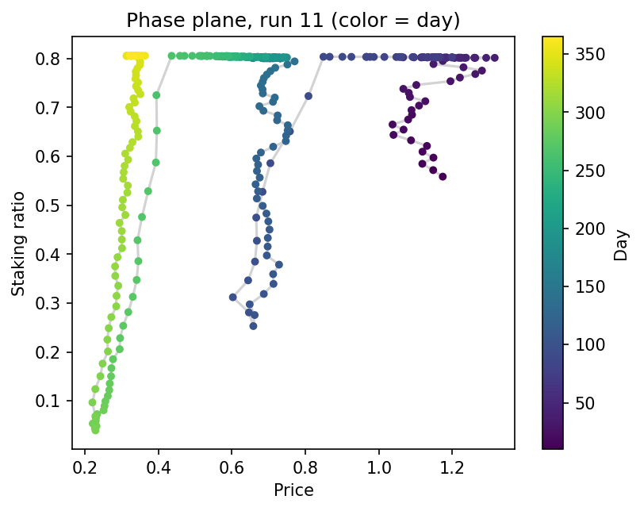

# Staking Stability Under Volatility: a cadCAD Monte Carlo Study

When does a token staking protocol stay stable, and when does staking collapse? This project simulates a staking protocol in [cadCAD](https://github.com/cadCAD-org/cadCAD), runs thousands of simulated years, and maps how daily price volatility and the price impact of staking flows decide the outcome.

**Notebook:** [`cadcad-staking-simulation.ipynb`](cadcad-staking-simulation.ipynb)

## Headline result

At 3% daily volatility and moderate price impact, **39.8% (plus or minus 3 points) of 1,000 simulated years saw staking fall below 50% of supply.** The other 60% saw no crisis at all. Crises lasted about a month on average, and the longest lasted 83 days.

Most years are fine, but when a crisis happens it is long. The average (12.5 days) hides this split.

## The model

- **State:** total staked, circulating supply, price, a moving average of price, APY, and daily net staking flow. The simulation starts with 40% of supply staked and runs for 365 days.
- **Agents:** stake 3% of liquid supply per day when APY is above 10%. Panic-unstake 10% of stake per day when price falls more than 15% below its moving average.
- **Price:** a random daily shock (volatility sigma) plus a push from net staking flow (price impact).
- **Rewards:** 8% annual inflation paid to stakers, so APY falls as more is staked. Staking stops climbing near 80% of supply, where APY reaches the 10% threshold.
- **Three update blocks per day,** run in order: agents decide, price moves, rewards and APY update.

Random shocks are seeded by run number and day, so each run is different and every result can be reproduced exactly.

## What I found

### Volatility sets the regime

I swept daily volatility (0.015 to 0.04) against price impact (0.25, 0.5, 1.0), with 100 runs per cell. A run counts as a crash if staking drops below 50% of supply after a 10-day warm-up. Crashes are rare below about 0.02 volatility and common above 0.035. The transition is gradual, between roughly 0.025 and 0.035.

### Price impact lowers the tipping point

The 50% crash share is reached near sigma 0.030 at impact 1.0, 0.031 at 0.5, and 0.035 at 0.25 (linear interpolation, about plus or minus 0.002). Stronger flow-to-price feedback means instability starts at lower volatility.

### Crises last longer when impact is high

At sigma 0.04, crash frequency is near saturation, but the average time spent below 50% staking still rises from 23 days (impact 0.25) to 58 days (impact 1.0).

### What a crash looks like

Staking sits at its ceiling until price falls sharply relative to its recent average. Panic unstaking then compounds at 10% of the remaining stake per day, pushing price down further. Staking later recovers as APY rises. The phase plane shows one illustrative run with color marking the day (the first cluster is the initial climb, not a crash).

## Limitations

- **Crashes always recover.** APY is paid in tokens, so lower staking raises APY and pulls stakers back. This model produces boom-bust cycles, not permanent death spirals.
- Agents are aggregate rules, not individuals with different thresholds.
- Price has no drift and no order-book model.
- Sweep cells use 100 runs, so shares near 50% carry roughly plus or minus 10 points of noise. The 1,000-run result narrows this to about plus or minus 3.
- The 50% threshold, 10-day warm-up and 365-day horizon are modeling choices. Crises still running on day 365 are cut off.

## Next steps

- Pay yield in USD terms, so a falling price also lowers real yield, to test whether spirals become permanent.
- Heterogeneous agents with different APY thresholds and panic triggers.
- Calibrate volatility and flow impact to a real network.

## Run it yourself

Open the notebook in Google Colab and run all cells. Expect about 15 to 20 minutes on the free tier. The parameter sweep runs in chunks to stay within memory. Outputs: `summary.csv` (the 18-row sweep table) and the PNG charts above.

## Tools

cadCAD, Python, pandas, numpy, matplotlib, seaborn.
